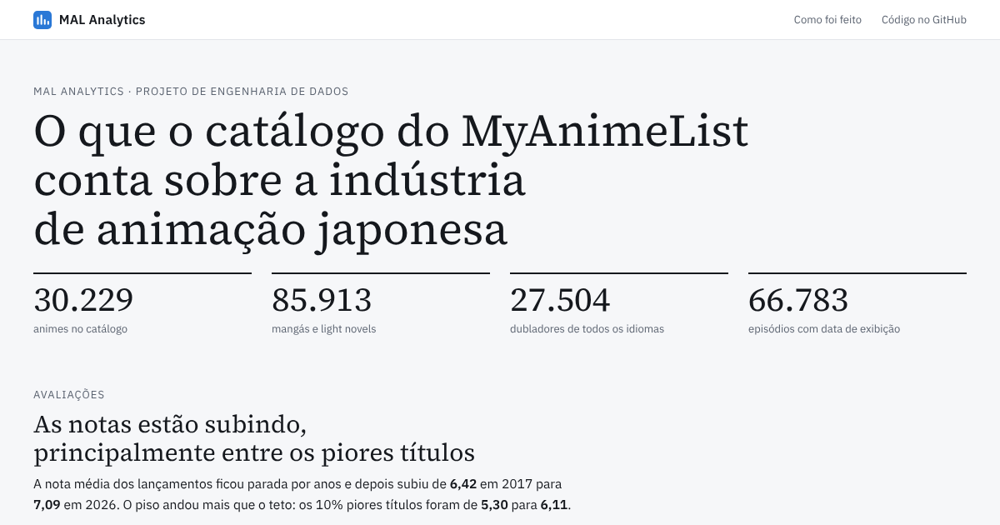
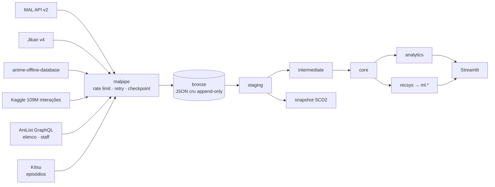
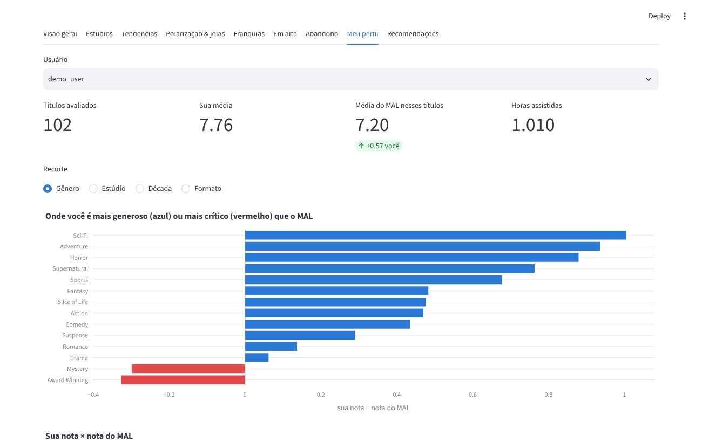
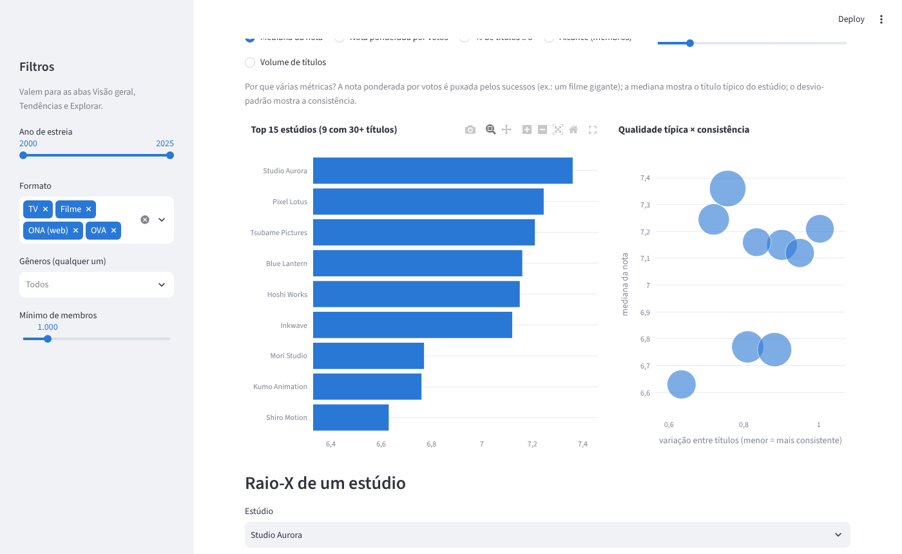
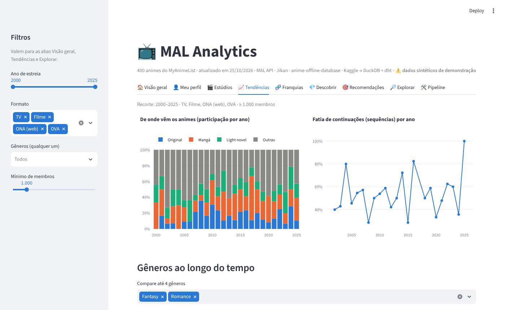
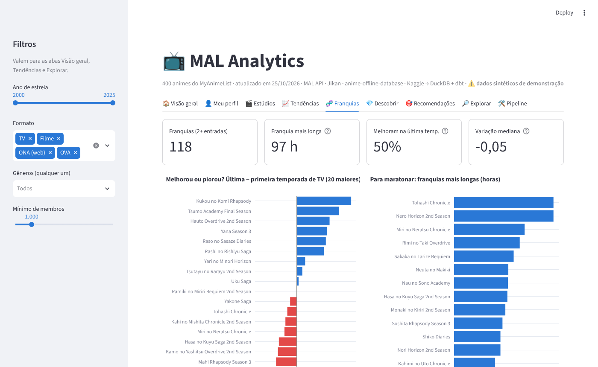
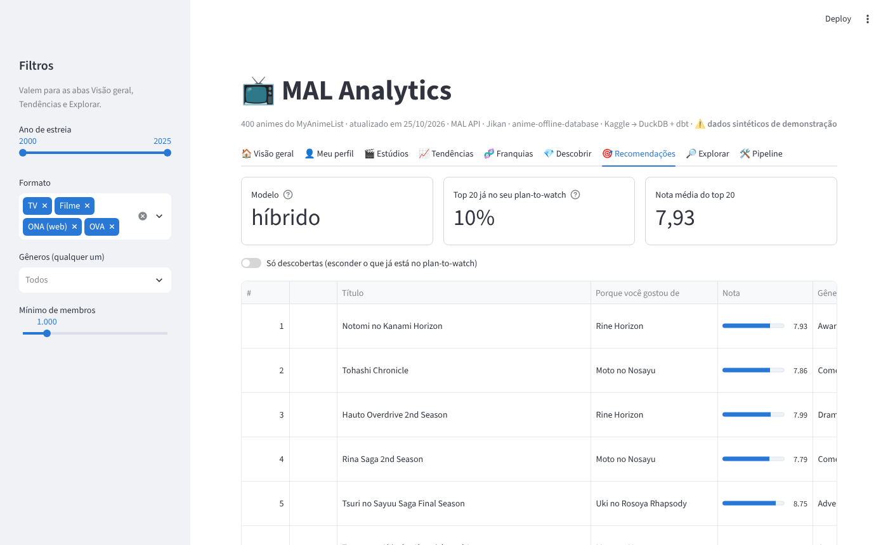

# MAL Analytics — engenharia e analytics engineering sobre o MyAnimeList

[](https://github.com/GabrielKSG7/MAL-ANALYTICS/actions/workflows/ci.yml)
[](https://gabrielksg7.github.io/MAL-ANALYTICS/)


Pipeline de dados ponta a ponta que monta uma base analítica própria do **MyAnimeList** a partir de
quatro fontes, modela tudo em camadas com **dbt + DuckDB**, treina e avalia **recomendadores** e
entrega um **dashboard** — com testes, CI e documentação.

> *TL;DR (EN): end-to-end data project on MyAnimeList data — polite API ingestion with checkpointing
> into an append-only bronze layer, dbt medallion-style modeling (staging → intermediate → core →
> analytics) with data tests, unit tests, contracts, snapshot and an incremental fact, a numpy/scipy
> recommender with offline evaluation, and a Streamlit dashboard. Runs fully offline on synthetic data for CI.*

### ▶ [Ver o painel público com os dados reais](https://gabrielksg7.github.io/MAL-ANALYTICS/)

[](https://gabrielksg7.github.io/MAL-ANALYTICS/)
<sub>Página estática gerada pelo próprio pipeline (`malpipe site`) e publicada no GitHub Pages: seis
achados, dubladores, obras sem anime e o recomendador, com os números da carga real de novembro/2026.</sub>

---

## Por que este projeto

O MAL não oferece download da base. Para fazer perguntas que o site não responde — *qual estúdio é
mais consistente? as notas estão inflando? quais animes dividem opiniões? onde meu gosto diverge da
comunidade?* — é preciso **construir a base**. Isso exige os problemas reais de engenharia de dados:
APIs com rate limit, cargas de horas que podem cair no meio, JSON aninhado e inconsistente, dados
parciais, integração de fontes com chaves diferentes e qualidade de dados verificável.

## O que os dados mostram

> Primeira carga real em **1º/nov/2026**: **30.229 animes** extraídos da MAL API (todos com HTTP 200,
> ~9h40 a 1 req/s), cruzados com o anime-offline-database. Números das marts `analytics.*`.

**1. As notas estão subindo — e o "chão" subiu mais que o "teto".**
A nota média dos títulos estreados por ano (TV, filme e ONA) ficou estável entre **6,4 e 6,5** de 2011 a
2017, e desde então sobe sem parar: **6,65** (2020) → **6,98** (2024) → **7,09** (2026, ano em curso).
O percentil 10 foi de **5,30 → 6,03** entre 2017 e 2024, enquanto o percentil 90 andou bem menos
(**7,64 → 7,97**): há menos títulos muito mal avaliados. Ressalva: títulos recentes são votados primeiro
pelos fãs mais engajados, e a nota tende a assentar com o tempo — a série semanal
(`fct_anime_metrics_snapshot`) vai permitir medir esse efeito.
→ `mart_score_inflation`

**2. O anime original está sumindo; adaptação de mangá e light novel domina.**
Média das temporadas com 50+ títulos com nota:

| Ano | Original | Mangá | Light novel | Sequências |
|---|---|---|---|---|
| 2016 | 41% | 25% | 4% | 25% |
| 2020 | 34% | 24% | 6% | 28% |
| 2024 | 25% | 32% | 11% | 34% |
| 2026 | 15% | 45% | 17% | 34% |

→ `mart_season_trends`

**3. "Melhor estúdio" depende da métrica — e isso é o achado.**
Entre estúdios com 30+ títulos, a nota bayesiana ponderada por votos põe no topo **Wit Studio (8,31)**,
**Studio Ghibli (8,28)**, **CoMix Wave Films (8,19)** e **ufotable (8,19)**. Só que a ponderação por votos é
puxada pelos sucessos: a CoMix Wave chega lá graças a *Kimi no Na wa.*, mas a **mediana** dos seus 61 títulos
é **5,69**. Consistência sozinha também engana — o estúdio com menor variação entre 100+ títulos (AQUA ARIS,
desvio 0,28) é consistentemente mediano (mediana 5,80). Combinando escala e qualidade, **Kyoto Animation**
tem a maior mediana entre estúdios com 100+ títulos (**7,56**), seguida por **Bones** (7,31) e **Shaft** (7,27),
e Bones e KyoAni estão entre os mais consistentes do top 20 (desvio ≈ 0,66). Em alcance, **A-1 Pictures**
(68,8 mi de membros somados) e **Madhouse** (64,7 mi) lideram.
→ `mart_studio_performance`

**4. As melhores temporadas da história, pelo título de topo:** *Sousou no Frieren* (outono/2023, **9,24**),
*Fullmetal Alchemist: Brotherhood* (primavera/2009, **9,11**), *Steins;Gate* (primavera/2011, **9,07**) e
*Re:Zero 4th Season* (primavera/2026, **9,07**).

**5. Meu perfil contra o MAL** (lista pública [`gabu_rieru`](https://myanimelist.net/animelist/gabu_rieru),
778 títulos com nota, ~4.400 horas assistidas):
- Sou, em média, **0,53 ponto mais crítico** que a comunidade (7,00 × 7,53), com correlação de **0,65**.
- Fico **acima** do MAL em *Award Winning* (+0,25), *Avant Garde* (+0,38) e em estúdios autorais como
  **Khara** (+0,74), **Shaft** (+0,63) e **Trigger** (+0,58).
- Fico bem **abaixo** em *Harem* (−1,70), *Ecchi* (−1,28) e *Horror* (−1,18), e em estúdios como
  **Lerche** (−1,64), **TMS** (−1,46), **J.C.Staff** (−1,37) e **Studio Pierrot** (−1,06).
- Filmes são onde mais concordo com a comunidade (−0,26); séries de TV, onde menos (−0,73).
→ `mart_my_profile_vs_mal`

**6. O recomendador "adivinhou" a minha fila.** Só com o modelo de conteúdo (sem dados de outros
usuários ainda), **18 dos 20** primeiros recomendados já estavam no meu *plan-to-watch* — de uma fila de
2.021 títulos num catálogo de 8.489 candidatos (ao acaso, seriam no máximo ~26%). O dashboard tem um filtro para mostrar só descobertas novas.
→ `ml.recommendations_for_user`

### Ecossistema: pessoas e episódios

> Carga de **3–4/nov/2026** pela AniList (elenco e staff de ~30 mil animes), Kitsu (guia de episódios) e
> MAL (85.913 mangás e light novels). → `malpipe ecosystem`, ver [ADR 005](docs/adr/005-ecossistema-multifonte.md).

**7. Quem mais dublou.** São **27,5 mil dubladores** em 24 idiomas (9,7 mil japoneses). Em número de
personagens, lideram **Takehito Koyasu** (443 personagens em 676 animes — o mais querido é *Dio Brando*),
**Tomokazu Sugita** (403, *Joseph Joestar*), **Katsuyuki Konishi** (344, *Kamina*), **Takahiro Sakurai** (343)
e **Kana Hanazawa** (337) — que é, de longe, quem mais fez **protagonistas** (164; o 2º, Sakurai, tem 129).
Em **público alcançado** (soma de membros dos animes), o topo é Sakurai (175,8 mi), Koyasu, **Junichi Suwabe**
(*Sukuna*) e **Yuuki Kaji** (*Eren*). Entre os 100 dubladores japoneses mais ativos, 62 são homens. Na
dublagem em português, **Tatiane Keplmair** (*Nami*), **Tatá Guarnieri** (*Kenshin*) e **Fernanda Bullara**
(*Asuka*) são as vozes com mais personagens.
→ `mart_voice_actor_ranking`

**8. As duplas que mais contracenaram** vêm das franquias com filme todo ano: **Minami Takayama × Kappei
Yamaguchi** (46 animes juntos — Conan e Shinichi), **Ikue Ootani × Rica Matsumoto** (42 — Pikachu e Ash) e
**Kiyoshi Kobayashi × Kanichi Kurita** (39 — Jigen e Lupin). Na geração seguinte, **Hiroshi Kamiya × Daisuke
Ono** somam 35 obras (*Durarara!!*, *Osomatsu-san*, *Working!!*, *Shingeki no Kyojin*…). O grafo tem
59 mil pares. → `mart_seiyuu_network`

**9. Diretores: a mesma lição dos estúdios.** Entre 1.037 diretores com 3+ obras com nota, os de maior
mediana com 5+ obras são **Chizuru Miyawaki** (8,88 — *Gintama*), **Tatsuya Oishi** (8,36 — *Monogatari*),
**Masashi Koizuka** (8,28 — *Shingeki no Kyojin*) e **Satoshi Kon** (8,25). Com escala, se destacam
**Susumu Mitsunaka** (12 obras, mediana 8,17 — *Haikyuu!!*), **Haruo Sotozaki** (11, 8,14 — *Kimetsu no Yaiba*)
e **Nobutaka Yoda** (17, 8,14 — *Fruits Basket*). Ponderando pelo público, **Yasuhiro Irie** (*FMA:
Brotherhood*, 8,79) e **Hiroshi Koujina** (*Hunter x Hunter* 2011, 8,77) lideram. E de novo a consistência
sozinha engana: os diretores com menor variação (8+ obras) têm medianas entre 5 e 6.
→ `mart_director_performance`

**10. O episódio encolheu — e voltou.** No guia de **66,8 mil episódios** do Kitsu, a duração média ponderada
foi de **24,6 min** (1975–89) para **19,8 min** (2013–16, auge das séries curtas) e voltou a **~22 min**
(2017–19). Ressalva: a cobertura do Kitsu despenca a partir de 2020 (125 episódios datados em 2020 contra
1.952 em 2019), então os anos recentes não entram na conclusão. → `mart_episode_trends`

### Mangá × anime

> 85.913 mangás, light novels e manhwas do MAL. A ligação com o anime vem das relações da AniList (obra
> de origem de cada anime), porque o `related_anime` da MAL API não trouxe nenhuma.

**11. O anime raramente supera a obra original.** Em **2.896 animes com uma única obra de origem**
(1.944 mangás e novels), o anime teve nota **maior** que o original em só **21%** dos casos; a diferença
mediana é de **−0,33** ponto, e um terço (34%) fica num empate técnico (±0,25).
- **Light novel é o original mais difícil de superar**: mediana de −0,50 e só 11% de animes melhores
  (mangá: −0,30 e 23%). Em manhwa, só 3 de 39 adaptações superaram o original.
- **Série de TV adapta melhor** (−0,32) que filme (−0,53) e ONA (−0,67).
- Entre estúdios com 30+ adaptações, os que ficam mais perto do original são **Bones** (−0,13),
  **Production I.G** (−0,18), **Doga Kobo** (−0,20), **Studio Pierrot** (−0,21) e **MAPPA** (−0,23); os que
  mais se afastam, **Shin-Ei** (−0,59), **Lerche** (−0,54), **Gonzo** (−0,51) e **Studio Deen** (−0,48).
- Maiores viradas a favor do anime: *Usagi Drop* (+1,37, Production I.G), *Kurenai no Buta* sobre
  *Hikoutei Jidai* (+1,29, Ghibli) e *Bleach: Sennen Kessen-hen* (8,97 contra 7,93 do mangá). As maiores
  quedas: *One Punch Man 3* (4,77 contra 8,68), *Berserk* de 2016 (6,34 contra 9,46) e a 2ª temporada de
  *Yakusoku no Neverland* (5,23 contra 8,14).
- A espera dobrou: o intervalo mediano entre o início da obra e o anime foi de **3 anos** (estreias até
  1999) para **6 anos** (2021 em diante).

Ressalva: as notas de mangá vêm de outro público — leitores, em menor número e mais engajados —, então
parte da diferença é de quem vota, não só de qualidade. → `mart_adaptation_scores`

**12. O que ainda não virou anime.** São cerca de **1,6 mil obras** com nota ≥ 7,5 e 1.000+ votos sem
nenhuma ligação com anime. As mais populares: *Oyasumi Punpun* (532 mil membros), *Vagabond* (a de maior
nota, **9,27**), *20th Century Boys*, *Fire Punch* e *JoJolion*. Alguns autores aparecem duas vezes no
topo — **Takehiko Inoue** (*Vagabond* e *Real*, 8,98), **Tatsuki Fujimoto** (*Fire Punch* e *Sayonara
Eri*), **Inio Asano** (*Punpun* e *Solanin*) e **Naoki Urasawa** (*20th* e *21st Century Boys*) —, e
**1 em cada 5 é manhwa**. → `mart_manga_adaptation_gap`

<sub>Pendentes: polarização (depende do Jikan), "em alta" (depende da 2ª extração semanal) e o
recomendador colaborativo (depende do Kaggle).</sub>

## Arquitetura



| Fonte | O que entrega | Por quê |
|---|---|---|
| **MAL API v2** (oficial) | metadados, nota, rank, membros, status, relações, sua lista | fonte de verdade |
| **Jikan v4** | distribuição de notas 1–10, recomendações da comunidade, elenco | o que a API oficial não tem |
| **anime-offline-database** | IDs cruzados (AniList, Kitsu, AniDB), tags temáticas | universo de IDs + ponte entre sites |
| **Kaggle (2020)** | ~109M interações usuário × anime | comportamento real para o recomendador |
| **MAL API v2 — mangá** | mangás, light novels, autores, revistas, ligação com o anime | adaptação × obra original |
| **AniList GraphQL** | personagens, dubladores por idioma, staff com papel, fichas de pessoas | o "quem fez" de cada anime |
| **Kitsu** | guia de episódios (título, data, duração) | o grão mais fino: episódio |

Detalhes: [docs/architecture.md](docs/architecture.md) · limites e termos de uso: [docs/data-sources.md](docs/data-sources.md)

## Destaques técnicos

**Ingestão (`src/malpipe`)**
- `PoliteClient`: intervalo mínimo entre requisições, backoff exponencial com jitter, respeito ao `Retry-After`, 404 tratado como resultado definitivo.
- **Bronze append-only com o JSON cru** — reprocessar o modelo inteiro não faz nenhuma chamada de rede ([ADR 002](docs/adr/002-bronze-append-only-json.md)).
- **Checkpoint derivado do próprio bronze**: a fila é "IDs conhecidos − sucesso recente − 404". Se cair, roda de novo e continua.
- Observabilidade em `meta.runs` (cada execução, status, linhas, notas) e teste de dados que alerta se a última execução teve >20% de falhas.
- **Carga do ecossistema em paralelo** (`malpipe ecosystem`): mangá, AniList e Kitsu ao mesmo tempo, uma thread por host com rate limiter próprio e escrita serializada no DuckDB — ~20 h em vez de ~35 h ([ADR 005](docs/adr/005-ecossistema-multifonte.md)).
- Cliente **GraphQL** com paginação aninhada (personagens e staff), diretivas `@include` para não rebuscar o que já veio e erro de GraphQL (HTTP 200) tratado como falha; **circuit breaker** de rede e `check-sources` para diagnóstico.
- Kaggle carregado com o `read_csv` paralelo do DuckDB (sem passar pelo pandas), com amostragem determinística de usuários para desenvolvimento.

**Modelagem (`dbt/`)** — 63 modelos + 1 snapshot, 121 testes de dados, 3 unit tests
- **Staging** parseia o JSON (`->>`, `from_json`, `unnest`), trata contadores que chegam como string, datas parciais do MAL (`"2015-04"`) e aplica "última extração vence".
- **Franquias por grafo**: componentes conexos das relações sequel/prequel/side story via **CTE recursiva**.
- **Nota bayesiana** (fórmula IMDb) e **índice de polarização** a partir da distribuição de votos ([ADR 003](docs/adr/003-metricas-de-qualidade.md)).
- **Escala**: JSONs grandes (mangá, AniList com elenco e staff) são lidos uma única vez com `from_json` tipado e a deduplicação usa junção por `max(extracted_at)` em vez de janela — o modelo de mangá caiu de >1,2 GB para <300 MB de memória.
- **Papéis de staff normalizados** por regex ("Chief Director", "Episode Director (ep 3)"…) em 13 grupos testados; elenco por idioma; episódios com intervalo entre exibições (`lag`).
- **Fato incremental** (`fct_anime_metrics_snapshot`, `delete+insert`) que vira série temporal semana a semana.
- **Snapshot SCD2** de status de exibição/episódios; **contracts** em dimensões; **exposures** ligando dashboard e recomendador ao lineage; **source freshness**.
- Testes genéricos próprios (`value_between`, `unique_combination`, `null_ratio_below`…) e **unit tests** dos modelos com lógica (grafo, polarização, bayes).

**Recomendador (`src/malpipe/recsys`)** — [ADR 004](docs/adr/004-recomendador.md)
- Popularidade (baseline), item-kNN com shrinkage (calculado em blocos), SVD com fold-in, conteúdo (TF-IDF de gêneros/tags/estúdio) e híbrido.
- Avaliação offline com holdout: precision/recall/NDCG@10, **cobertura de catálogo** e **novidade** — e concordância dos vizinhos com as recomendações votadas pela comunidade no Jikan.
- Recomendações para a sua lista com explicação: *"porque você deu nota alta para X"*.

**Dashboard (`dashboard/`)** — Streamlit com 10 abas
- Painel executivo (KPIs + gráficos com texto explicando cada número) e aba **Explorar** com filtros
  globais (ano, formato, gêneros, audiência), busca e download do recorte em CSV.
- Pôsteres e links do MAL nas tabelas, raio-X por estúdio, linha do tempo por franquia, temporada em
  detalhe, perfil pessoal contra a comunidade e aba de **saúde do pipeline**.
- Aba **Ecossistema**: ranking de dubladores, duplas que mais contracenaram, diretores (volume × nota),
  guia de episódios e mangá × anime (a adaptação superou o original? quais populares ainda não viraram anime?).
- Conexões curtas e somente leitura: o painel aberto não trava a ingestão.

**Painel público (`site/`)** — [ADR 006](docs/adr/006-painel-publico-estatico.md)
- `malpipe site` consulta as marts e grava só números agregados em `site/data/*.json`; a página
  estática (d3, fontes e scripts hospedados no próprio repositório) desenha os gráficos no navegador.
- O workflow `pages.yml` confere a página (`scripts/check_site.py`) e publica no GitHub Pages a cada
  push em `site/`. O build local já atualiza os dados: o painel acompanha o pipeline.
- Imagem de prévia (Open Graph) para o link aparecer com destaque no LinkedIn.

**Consulta em SQL (DBeaver)** — `malpipe publish` gera uma cópia de consulta independente do banco de
trabalho e `sql/consultas_dbeaver.sql` traz 38 consultas prontas ([guia](docs/dbeaver.md)).

**Engenharia**
- 39 testes Python (HTTP e GraphQL mockados com `respx`, paginação, checkpoint, loaders, recsys) · ruff · GitHub Actions rodando o **pipeline inteiro** (sintético + manami real) a cada push.
- Gerador de **dados sintéticos no formato exato das APIs**: o projeto roda sem credenciais e o CI é determinístico.
- Dicionário de dados gerado automaticamente do manifest do dbt.

## Perguntas que o projeto responde

| Pergunta | Onde |
|---|---|
| Quais estúdios entregam mais qualidade — e com mais consistência? | `analytics.mart_studio_performance` |
| As notas estão inflando com o tempo? | `analytics.mart_score_inflation` |
| Como cada gênero evoluiu em participação e nota? | `analytics.mart_genre_trends` |
| Quais animes dividem opiniões ("ame ou odeie")? | `analytics.mart_polarizing_anime` |
| Quais são as joias escondidas (nota alta, pouca gente viu)? | `analytics.mart_hidden_gems` |
| Franquias melhoram ou pioram ao longo das temporadas? | `analytics.mart_franchise_summary` |
| O que está subindo esta semana? | `analytics.mart_anime_trending` |
| Que gêneros as pessoas mais abandonam? | `analytics.mart_drop_rate_by_genre` |
| Onde o meu gosto diverge da comunidade? | `analytics.mart_my_profile_vs_mal` |
| Quais dubladores mais trabalham juntos? | `analytics.mart_seiyuu_network` |
| Quem mais dublou — e em obras de que nível? | `analytics.mart_voice_actor_ranking` |
| Quais diretores são mais consistentes? | `analytics.mart_director_performance` |
| Os episódios estão ficando mais curtos? Quantos vão ao ar por ano? | `analytics.mart_episode_trends` |
| O anime costuma superar o mangá/light novel original? | `analytics.mart_adaptation_scores` |
| Que mangás populares ainda não viraram anime? | `analytics.mart_manga_adaptation_gap` |
| O que eu deveria assistir agora? | `ml.recommendations_for_user` |

<table><tr>
<td></td>
<td></td>
</tr><tr>
<td></td>
<td></td>
</tr><tr>
<td colspan="2"></td>
</tr></table>

## Como rodar

### 1. Demonstração em 1 minuto (sem credenciais)

```bash
git clone https://github.com/GabrielKSG7/MAL-ANALYTICS.git
cd MAL-ANALYTICS
python -m venv .venv && source .venv/bin/activate     # Windows: .venv\Scripts\Activate.ps1
pip install -e ".[dev,dashboard]"

make demo          # Windows: .\scripts\tasks.ps1 demo
DUCKDB_PATH=$PWD/data/demo.duckdb make dashboard
```

`make demo` gera dados **sintéticos** no formato das APIs → `dbt build` (modelos + testes) → treina os recomendadores.

### 2. Com os dados reais

```bash
cp .env.example .env                 # MAL_CLIENT_ID e MAL_USERNAME
malpipe manami                       # ~30 mil IDs do MAL em segundos
malpipe discover --seasons 1960-2027
malpipe mal-details                  # carga longa (~8 h a 1 req/s); retomável
malpipe jikan statistics
malpipe my-list
malpipe kaggle data/raw/animelist.csv   # ver docs/data-sources.md
malpipe check-sources                # testa todas as fontes em segundos
malpipe ecosystem                    # mangá + elenco/staff + episódios em paralelo (~20 h, retomável)
make build && make dashboard
```

Rotina semanal: `malpipe incremental && make build` — agendamento no Windows e no cron em [docs/runbook.md](docs/runbook.md).

### Comandos

```
malpipe init | status | sample | manami | discover | mal-details | jikan | my-list | kaggle | incremental
        manga | anilist | anilist-relations | kitsu | ecosystem | check-sources | merge | recommend | dbt | publish | site | export
make demo | ingest | ecosystem | sources | build | publish | site | site-preview | dbt-build | dbt-docs | recommend | dashboard | test | lint
```

## Estrutura

```
├── src/malpipe/            # ingestão (CLI typer)
│   ├── http.py             #   cliente com rate limit / retry / circuit breaker (GET e POST)
│   ├── warehouse.py        #   bronze, meta.runs, checkpoint
│   ├── sources/            #   mal_api (anime + mangá) · anilist · kitsu · jikan · manami · kaggle
│   ├── sample_data.py      #   gerador sintético no formato das APIs
│   └── recsys/             #   modelos, avaliação, pipeline
├── dbt/
│   ├── models/staging/     #   1 view por entidade/fonte
│   ├── models/intermediate/#   franquias, bayes, polarização, normalização (+ unit tests)
│   ├── models/marts/core/  #   dims, bridges, fatos (incremental), contracts
│   ├── models/marts/analytics/  # marts por pergunta + exposures
│   ├── snapshots/  tests/  macros/  analyses/
├── dashboard/              # Streamlit: app.py (10 abas) + lib.py (filtros, formatação, estilo)
├── site/                   # painel público (GitHub Pages): index.html, assets/, data/*.json agregados
├── sql/                    # 38 consultas prontas para o DBeaver (validadas no CI)
├── tests/                  # pytest
├── docs/                   # arquitetura, fontes, runbook, ADRs, dicionário de dados
└── .github/workflows/      # ci.yml (pipeline inteiro) · pages.yml (publica o painel)
```

## Documentação

- [Arquitetura e modelo dimensional](docs/architecture.md)
- [Fontes, limites e termos de uso](docs/data-sources.md)
- [Runbook (operação, agendamento, diagnóstico)](docs/runbook.md)
- [Consultando no DBeaver](docs/dbeaver.md) — cópia de consulta + 38 consultas prontas
- [Dicionário de dados](docs/data-dictionary.md) — gerado do dbt
- Decisões: [001 DuckDB](docs/adr/001-duckdb-como-warehouse.md) · [002 Bronze append-only](docs/adr/002-bronze-append-only-json.md) · [003 Métricas de qualidade](docs/adr/003-metricas-de-qualidade.md) · [004 Recomendador](docs/adr/004-recomendador.md) · [005 Ecossistema multifonte](docs/adr/005-ecossistema-multifonte.md) · [006 Painel público estático](docs/adr/006-painel-publico-estatico.md)
- Lineage interativo: `make dbt-docs`

## Roadmap

- [x] Primeira carga real completa e uma seção de achados neste README
- [ ] Polarização com Jikan, recomendador colaborativo com Kaggle e série temporal semanal
- [x] Ecossistema: mangá × adaptação, elenco e staff (AniList), episódios (Kitsu)
- [x] Achados do ecossistema com os dados reais nesta página
- [ ] ALS para feedback implícito e embeddings de sinopse no modelo de conteúdo
- [x] Publicar um painel público gerado pelo pipeline (GitHub Pages)
- [ ] Atualização semanal automática, orquestração com Dagster e "Pergunte ao banco" (texto → SQL com LLM)

## Como foi construído

O projeto foi desenvolvido com o **Claude** (Anthropic) como par de programação: código, testes,
documentação e investigação de erros foram feitos em conjunto, e os commits registram essa coautoria.
As decisões de escopo, as fontes e a validação dos resultados com os dados reais passaram pelo autor —
foi revisando os números que apareceu, por exemplo, a falha na ligação mangá × anime descrita no
[ADR 005](docs/adr/005-ecossistema-multifonte.md).

## Uso dos dados

Projeto pessoal e não comercial. Nenhum dado bruto das APIs é versionado aqui — só os números
agregados do painel público (`site/data/`), os mesmos citados neste README. MyAnimeList é marca de seus
respectivos donos; este projeto não é afiliado ao MAL, ao Jikan, à AniList nem ao Kitsu. O anime-offline-database é
distribuído sob ODbL/DbCL pelo manami-project. Código sob licença MIT.

---

Feito por **Gabriel Silva Grande** · [GitHub](https://github.com/GabrielKSG7)
