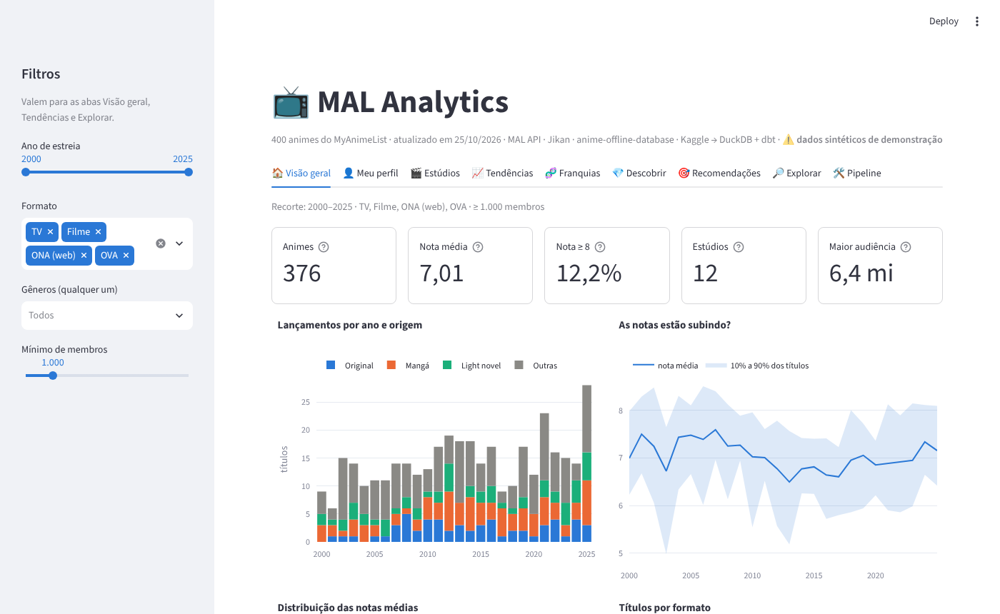
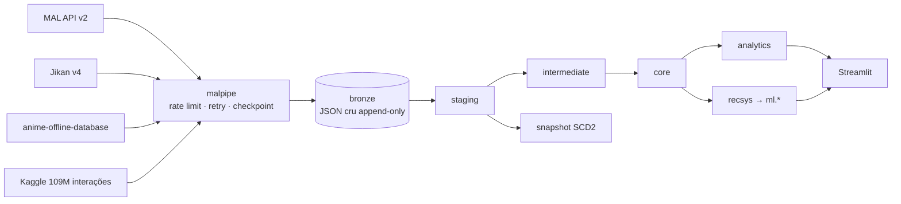
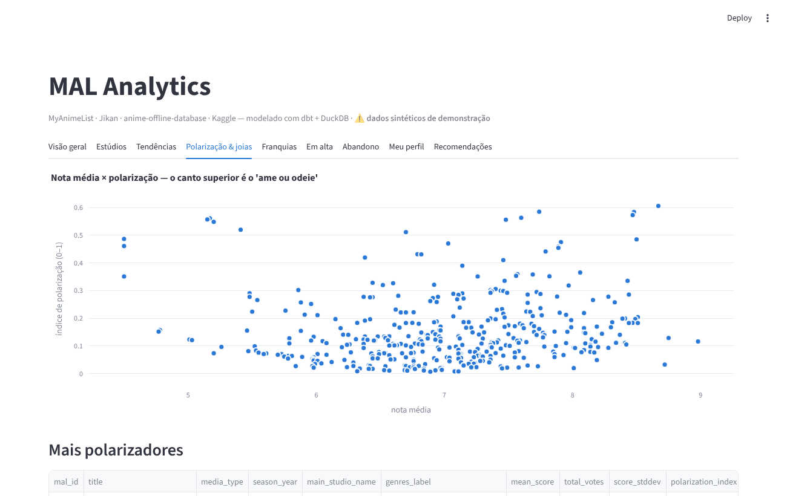

# MAL Analytics — engenharia e analytics engineering sobre o MyAnimeList

[](https://github.com/GabrielKSG7/MAL-ANALYTICS/actions/workflows/ci.yml)


Pipeline de dados ponta a ponta que monta uma base analítica própria do **MyAnimeList** a partir de
quatro fontes, modela tudo em camadas com **dbt + DuckDB**, treina e avalia **recomendadores** e
entrega um **dashboard** — com testes, CI e documentação.

> *TL;DR (EN): end-to-end data project on MyAnimeList data — polite API ingestion with checkpointing
> into an append-only bronze layer, dbt medallion-style modeling (staging → intermediate → core →
> analytics) with data tests, unit tests, contracts, snapshot and an incremental fact, a numpy/scipy
> recommender with offline evaluation, and a Streamlit dashboard. Runs fully offline on synthetic data for CI.*


<sub>Screenshots gerados com os dados sintéticos de demonstração (`make demo`).</sub>

---

## Por que este projeto

O MAL não oferece download da base. Para fazer perguntas que o site não responde — *qual estúdio é
mais consistente? as notas estão inflando? quais animes dividem opiniões? onde meu gosto diverge da
comunidade?* — é preciso **construir a base**. Isso exige os problemas reais de engenharia de dados:
APIs com rate limit, cargas de horas que podem cair no meio, JSON aninhado e inconsistente, dados
parciais, integração de fontes com chaves diferentes e qualidade de dados verificável.

## O que os dados mostram

> Primeira carga real em **1º/nov/2026**: **30.229 animes** extraídos da MAL API (todos com HTTP 200,
> ~9h40 a 1 req/s), cruzados com o anime-offline-database. Números das marts `analytics.*`.

**1. As notas estão subindo — e o "chão" subiu mais que o "teto".**
A nota média dos títulos estreados por ano (TV, filme e ONA) ficou estável entre **6,4 e 6,5** de 2011 a
2017, e desde então sobe sem parar: **6,65** (2020) → **6,98** (2024) → **7,09** (2026, ano em curso).
O percentil 10 foi de **5,30 → 6,03** entre 2017 e 2024, enquanto o percentil 90 andou bem menos
(**7,64 → 7,97**): há menos títulos muito mal avaliados. Ressalva: títulos recentes são votados primeiro
pelos fãs mais engajados, e a nota tende a assentar com o tempo — a série semanal
(`fct_anime_metrics_snapshot`) vai permitir medir esse efeito.
→ `mart_score_inflation`

**2. O anime original está sumindo; adaptação de mangá e light novel domina.**
Média das temporadas com 50+ títulos com nota:

| Ano | Original | Mangá | Light novel | Sequências |
|---|---|---|---|---|
| 2016 | 41% | 25% | 4% | 25% |
| 2020 | 34% | 24% | 6% | 28% |
| 2024 | 25% | 32% | 11% | 34% |
| 2026 | 15% | 45% | 17% | 34% |

→ `mart_season_trends`

**3. "Melhor estúdio" depende da métrica — e isso é o achado.**
Entre estúdios com 30+ títulos, a nota bayesiana ponderada por votos põe no topo **Wit Studio (8,31)**,
**Studio Ghibli (8,28)**, **CoMix Wave Films (8,19)** e **ufotable (8,19)**. Só que a ponderação por votos é
puxada pelos sucessos: a CoMix Wave chega lá graças a *Kimi no Na wa.*, mas a **mediana** dos seus 61 títulos
é **5,69**. Consistência sozinha também engana — o estúdio com menor variação entre 100+ títulos (AQUA ARIS,
desvio 0,28) é consistentemente mediano (mediana 5,80). Combinando escala e qualidade, **Kyoto Animation**
tem a maior mediana entre estúdios com 100+ títulos (**7,56**), seguida por **Bones** (7,31) e **Shaft** (7,27),
e Bones e KyoAni estão entre os mais consistentes do top 20 (desvio ≈ 0,66). Em alcance, **A-1 Pictures**
(68,8 mi de membros somados) e **Madhouse** (64,7 mi) lideram.
→ `mart_studio_performance`

**4. As melhores temporadas da história, pelo título de topo:** *Sousou no Frieren* (outono/2023, **9,24**),
*Fullmetal Alchemist: Brotherhood* (primavera/2009, **9,11**), *Steins;Gate* (primavera/2011, **9,07**) e
*Re:Zero 4th Season* (primavera/2026, **9,07**).

**5. Meu perfil contra o MAL** (lista pública [`gabu_rieru`](https://myanimelist.net/animelist/gabu_rieru),
778 títulos com nota, ~4.400 horas assistidas):
- Sou, em média, **0,53 ponto mais crítico** que a comunidade (7,00 × 7,53), com correlação de **0,65**.
- Fico **acima** do MAL em *Award Winning* (+0,25), *Avant Garde* (+0,38) e em estúdios autorais como
  **Khara** (+0,74), **Shaft** (+0,63) e **Trigger** (+0,58).
- Fico bem **abaixo** em *Harem* (−1,70), *Ecchi* (−1,28) e *Horror* (−1,18), e em estúdios como
  **Lerche** (−1,64), **TMS** (−1,46), **J.C.Staff** (−1,37) e **Studio Pierrot** (−1,06).
- Filmes são onde mais concordo com a comunidade (−0,26); séries de TV, onde menos (−0,73).
→ `mart_my_profile_vs_mal`

**6. O recomendador "adivinhou" a minha fila.** Só com o modelo de conteúdo (sem dados de outros
usuários ainda), **18 dos 20** primeiros recomendados já estavam no meu *plan-to-watch* — de uma fila de
2.021 títulos num catálogo de 8.489 candidatos (ao acaso, seriam no máximo ~26%). O dashboard tem um filtro para mostrar só descobertas novas.
→ `ml.recommendations_for_user`

<sub>Pendentes: polarização (depende do Jikan), "em alta" (depende da 2ª extração semanal) e o
recomendador colaborativo (depende do Kaggle).</sub>

## Arquitetura



| Fonte | O que entrega | Por quê |
|---|---|---|
| **MAL API v2** (oficial) | metadados, nota, rank, membros, status, relações, sua lista | fonte de verdade |
| **Jikan v4** | distribuição de notas 1–10, recomendações da comunidade, elenco | o que a API oficial não tem |
| **anime-offline-database** | IDs cruzados (AniList, Kitsu, AniDB), tags temáticas | universo de IDs + ponte entre sites |
| **Kaggle (2020)** | ~109M interações usuário × anime | comportamento real para o recomendador |

Detalhes: [docs/architecture.md](docs/architecture.md) · limites e termos de uso: [docs/data-sources.md](docs/data-sources.md)

## Destaques técnicos

**Ingestão (`src/malpipe`)**
- `PoliteClient`: intervalo mínimo entre requisições, backoff exponencial com jitter, respeito ao `Retry-After`, 404 tratado como resultado definitivo.
- **Bronze append-only com o JSON cru** — reprocessar o modelo inteiro não faz nenhuma chamada de rede ([ADR 002](docs/adr/002-bronze-append-only-json.md)).
- **Checkpoint derivado do próprio bronze**: a fila é "IDs conhecidos − sucesso recente − 404". Se cair, roda de novo e continua.
- Observabilidade em `meta.runs` (cada execução, status, linhas, notas) e teste de dados que alerta se a última execução teve >20% de falhas.
- Kaggle carregado com o `read_csv` paralelo do DuckDB (sem passar pelo pandas), com amostragem determinística de usuários para desenvolvimento.

**Modelagem (`dbt/`)** — 38 modelos + 1 snapshot, 92 testes de dados, 3 unit tests
- **Staging** parseia o JSON (`->>`, `from_json`, `unnest`), trata contadores que chegam como string, datas parciais do MAL (`"2015-04"`) e aplica "última extração vence".
- **Franquias por grafo**: componentes conexos das relações sequel/prequel/side story via **CTE recursiva**.
- **Nota bayesiana** (fórmula IMDb) e **índice de polarização** a partir da distribuição de votos ([ADR 003](docs/adr/003-metricas-de-qualidade.md)).
- **Fato incremental** (`fct_anime_metrics_snapshot`, `delete+insert`) que vira série temporal semana a semana.
- **Snapshot SCD2** de status de exibição/episódios; **contracts** em dimensões; **exposures** ligando dashboard e recomendador ao lineage; **source freshness**.
- Testes genéricos próprios (`value_between`, `unique_combination`, `null_ratio_below`…) e **unit tests** dos modelos com lógica (grafo, polarização, bayes).

**Recomendador (`src/malpipe/recsys`)** — [ADR 004](docs/adr/004-recomendador.md)
- Popularidade (baseline), item-kNN com shrinkage (calculado em blocos), SVD com fold-in, conteúdo (TF-IDF de gêneros/tags/estúdio) e híbrido.
- Avaliação offline com holdout: precision/recall/NDCG@10, **cobertura de catálogo** e **novidade** — e concordância dos vizinhos com as recomendações votadas pela comunidade no Jikan.
- Recomendações para a sua lista com explicação: *"porque você deu nota alta para X"*.

**Engenharia**
- 27 testes Python (HTTP mockado com `respx`, checkpoint, loaders, recsys) · ruff · GitHub Actions rodando o **pipeline inteiro** (sintético + manami real) a cada push.
- Gerador de **dados sintéticos no formato exato das APIs**: o projeto roda sem credenciais e o CI é determinístico.
- Dicionário de dados gerado automaticamente do manifest do dbt.

## Perguntas que o projeto responde

| Pergunta | Onde |
|---|---|
| Quais estúdios entregam mais qualidade — e com mais consistência? | `analytics.mart_studio_performance` |
| As notas estão inflando com o tempo? | `analytics.mart_score_inflation` |
| Como cada gênero evoluiu em participação e nota? | `analytics.mart_genre_trends` |
| Quais animes dividem opiniões ("ame ou odeie")? | `analytics.mart_polarizing_anime` |
| Quais são as joias escondidas (nota alta, pouca gente viu)? | `analytics.mart_hidden_gems` |
| Franquias melhoram ou pioram ao longo das temporadas? | `analytics.mart_franchise_summary` |
| O que está subindo esta semana? | `analytics.mart_anime_trending` |
| Que gêneros as pessoas mais abandonam? | `analytics.mart_drop_rate_by_genre` |
| Onde o meu gosto diverge da comunidade? | `analytics.mart_my_profile_vs_mal` |
| Quais dubladores mais trabalham juntos? | `analytics.mart_seiyuu_network` |
| O que eu deveria assistir agora? | `ml.recommendations_for_user` |

<table><tr>
<td></td>
<td></td>
</tr><tr>
<td></td>
<td></td>
</tr></table>

## Como rodar

### 1. Demonstração em 1 minuto (sem credenciais)

```bash
git clone https://github.com/GabrielKSG7/MAL-ANALYTICS.git
cd MAL-ANALYTICS
python -m venv .venv && source .venv/bin/activate     # Windows: .venv\Scripts\Activate.ps1
pip install -e ".[dev,dashboard]"

make demo          # Windows: .\scripts\tasks.ps1 demo
DUCKDB_PATH=$PWD/data/demo.duckdb make dashboard
```

`make demo` gera dados **sintéticos** no formato das APIs → `dbt build` (modelos + testes) → treina os recomendadores.

### 2. Com os dados reais

```bash
cp .env.example .env                 # MAL_CLIENT_ID e MAL_USERNAME
malpipe manami                       # ~30 mil IDs do MAL em segundos
malpipe discover --seasons 1960-2027
malpipe mal-details                  # carga longa (~8 h a 1 req/s); retomável
malpipe jikan statistics
malpipe my-list
malpipe kaggle data/raw/animelist.csv   # ver docs/data-sources.md
make build && make dashboard
```

Rotina semanal: `malpipe incremental && make build` — agendamento no Windows e no cron em [docs/runbook.md](docs/runbook.md).

### Comandos

```
malpipe init | status | sample | manami | discover | mal-details | jikan | my-list | kaggle | incremental | recommend | dbt
make demo | ingest | build | dbt-build | dbt-docs | recommend | dashboard | test | lint
```

## Estrutura

```
├── src/malpipe/            # ingestão (CLI typer)
│   ├── http.py             #   cliente com rate limit / retry
│   ├── warehouse.py        #   bronze, meta.runs, checkpoint
│   ├── sources/            #   mal_api · jikan · manami · kaggle
│   ├── sample_data.py      #   gerador sintético no formato das APIs
│   └── recsys/             #   modelos, avaliação, pipeline
├── dbt/
│   ├── models/staging/     #   1 view por entidade/fonte
│   ├── models/intermediate/#   franquias, bayes, polarização, normalização (+ unit tests)
│   ├── models/marts/core/  #   dims, bridges, fatos (incremental), contracts
│   ├── models/marts/analytics/  # marts por pergunta + exposures
│   ├── snapshots/  tests/  macros/  analyses/
├── dashboard/app.py        # Streamlit
├── tests/                  # pytest
├── docs/                   # arquitetura, fontes, runbook, ADRs, dicionário de dados
└── .github/workflows/ci.yml
```

## Documentação

- [Arquitetura e modelo dimensional](docs/architecture.md)
- [Fontes, limites e termos de uso](docs/data-sources.md)
- [Runbook (operação, agendamento, diagnóstico)](docs/runbook.md)
- [Dicionário de dados](docs/data-dictionary.md) — gerado do dbt
- Decisões: [001 DuckDB](docs/adr/001-duckdb-como-warehouse.md) · [002 Bronze append-only](docs/adr/002-bronze-append-only-json.md) · [003 Métricas de qualidade](docs/adr/003-metricas-de-qualidade.md) · [004 Recomendador](docs/adr/004-recomendador.md)
- Lineage interativo: `make dbt-docs`

## Roadmap

- [x] Primeira carga real completa e uma seção de achados neste README
- [ ] Polarização com Jikan, recomendador colaborativo com Kaggle e série temporal semanal
- [ ] Mangá (mesmos endpoints da API) e cruzamento adaptação × obra original
- [ ] ALS para feedback implícito e embeddings de sinopse no modelo de conteúdo
- [ ] Exportar marts em Parquet e publicar o dashboard

## Uso dos dados

Projeto pessoal e não comercial. Nenhum dado extraído é versionado aqui. MyAnimeList é marca de seus
respectivos donos; este projeto não é afiliado ao MAL nem ao Jikan. O anime-offline-database é
distribuído sob ODbL/DbCL pelo manami-project. Código sob licença MIT.

---

Feito por **Gabriel Silva Grande** · [GitHub](https://github.com/GabrielKSG7)
