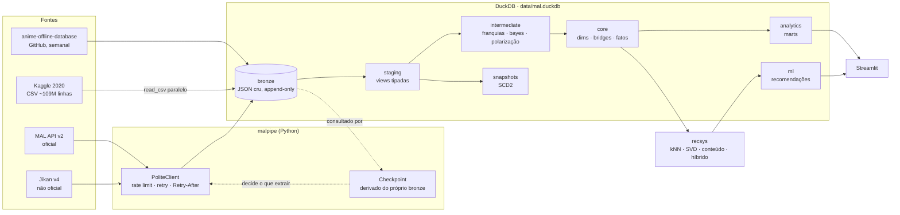
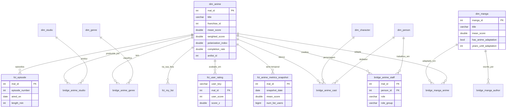

# Arquitetura

## Visão geral

## Camadas

| Camada | Materialização | Responsabilidade |
|---|---|---|
| `bronze` | tabelas append-only | O JSON exatamente como veio da API, com status HTTP, horário e `run_id`. Nunca é alterado. |
| `meta` | tabela | `meta.runs`: cada execução do pipeline (comando, início/fim, status, linhas, notas). |
| `staging` | views | Parsing do JSON, tipagem, datas parciais do MAL, "última extração vence". 1 modelo por entidade. |
| `intermediate` | views/tabela | Lógica reutilizável e testável isoladamente (com unit tests): franquias por grafo, nota bayesiana, forma da distribuição de notas, normalização por usuário. |
| `core` | tabelas (+1 incremental) | Modelo dimensional: `dim_anime`, `dim_genre`, `dim_studio`, `dim_person`, `dim_character`, pontes N:N e fatos. |
| `analytics` | tabelas | Uma mart por pergunta de negócio. É o que o dashboard consome. |
| `snapshots` | dbt snapshot | SCD tipo 2 de status de exibição, episódios e título. |
| `ml` | tabelas (Python) | Métricas dos modelos, animes similares e recomendações para a sua lista. |

## Modelo dimensional (core)

## Fluxo de uma execução semanal (`malpipe incremental`)

1. **manami** — baixa o snapshot semanal; se a `dataset_date` já existe no bronze, não faz nada (idempotente).
2. **descoberta** — varre as temporadas do ano anterior até o próximo (novos títulos e anúncios).
3. **detalhes MAL** — calcula a fila: IDs conhecidos (descobertos + manami) **menos** os extraídos com sucesso
   há menos de `REFRESH_DAYS` **menos** os que já deram 404. Falhas transitórias voltam para a fila.
4. **Jikan** — mesma lógica, para IDs que já têm detalhe do MAL (refresh 4× mais espaçado).
5. **sua lista** — extração completa (é pequena); o staging usa só a mais recente.
6. **dbt build** — o incremental `fct_anime_metrics_snapshot` acrescenta o dia novo; `mart_anime_trending` compara com a semana anterior.
7. **recommend** — retreina e regrava `ml.*`.

Se o processo cair no meio, basta rodar de novo: o que já foi gravado sai da fila automaticamente.

## Por que DuckDB?

Ver [ADR 001](adr/001-duckdb-como-warehouse.md). Em resumo: os ~109M de linhas do Kaggle cabem
num notebook; DuckDB lê CSV/JSON/Parquet nativamente, tem funções de JSON e listas excelentes,
e o projeto roda sem servidor. Migrar para Postgres/BigQuery/Snowflake depois é trocar o adapter do dbt.
