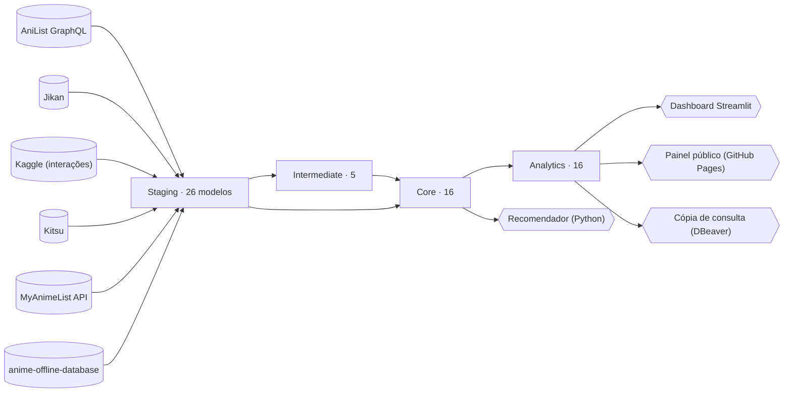
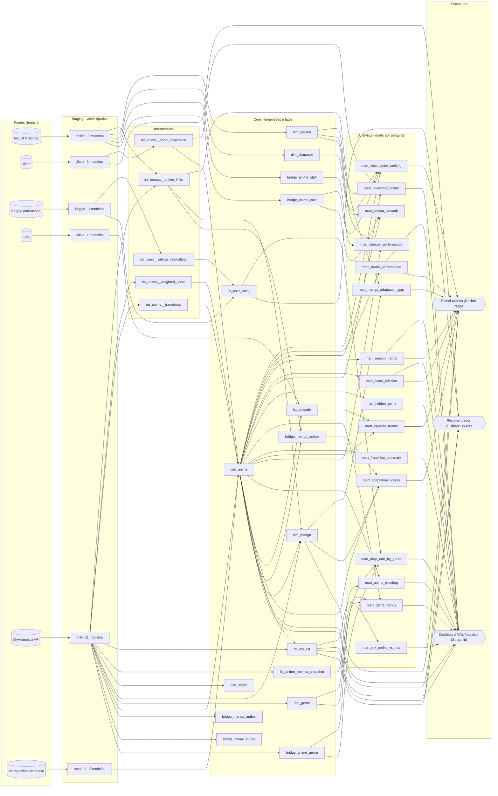

# Lineage

> Gerado por `scripts/gen_lineage.py` a partir do manifest do dbt — não edite à mão.
> Para o lineage interativo, modelo a modelo: `make dbt-docs`.

## Visão geral

## Modelo a modelo

Staging agrupado por fonte; da camada intermediate em diante, cada nó é um modelo.

